  

  

---

## 🧭 Sobre mim

Sou estudante de **Sistemas de Informação** no último ano na UNIPAR, em **Inajá – PR**, e desenvolvedor fullstack com foco em **Java/Spring Boot no backend** e **React no front**.

O que me interessa não é tecnologia isolada — é fazer software que aguenta operação real. Meu projeto principal é um **ERP para fecularia**, onde o sistema precisa lidar com balança rodoviária, rastreabilidade de lote, análise laboratorial e financeiro no mesmo fluxo. Isso me obrigou a aprender na prática modelagem de domínio, controle de transações, segurança com JWT e integração com gateway de pagamento.

Busco **estágio ou primeira oportunidade** como desenvolvedor backend ou fullstack.

---

## 📊 Números

  
  

  

---

## 🛠️ Stack

| Camada | Tecnologias |
|:--|:--|
| **Backend** |     |
| **Dados** |   |
| **Frontend** |     |
| **Integrações** |    |
| **Ferramentas** |     |

---

## 🚀 Projetos

### 🌾 [SIGFEC](https://github.com/PedroHeitor-Silva/SIGFEC) — ERP para fecularia

Sistema de gestão industrial completo, do recebimento da mandioca até o recebimento do pagamento.

| Módulo | O que resolve |
|:--|:--|
| **Pesagem** | Fluxo de balança rodoviária com tara automática, romaneio diário e comprovante |
| **Produção** | Lotes rastreáveis com rendimento e consumo de matéria-prima |
| **Laboratório** | Análises de qualidade vinculadas ao lote |
| **Estoque** | Movimentação com histórico e saldo por produto |
| **Vendas** | Pedido, tabela de preços e emissão |
| **Financeiro** | Contas a receber com cobrança via Asaas e baixa por webhook |
| **Acesso** | Login JWT, senhas em BCrypt, permissão por perfil e trilha de auditoria |

`Java 21` `Spring Boot` `Spring Security` `JPA/Hibernate` `PostgreSQL` `React 18` `Vite` `Tailwind 4`

### 🚗 [Carmax](https://github.com/PedroHeitor-Silva/Carmax) — Gestão de veículos

Aplicação fullstack com CRUD completo, comunicação front/back via API REST e geração de relatórios em PDF direto do navegador.

`React 19` `React Router` `jsPDF` `html2canvas` `API REST`

---

## 💡 O que eu já resolvi na prática

- 🔐 **Autenticação e autorização** — JWT com filtro próprio, BCrypt e controle de acesso por perfil de usuário
- 🧾 **API REST bem modelada** — DTOs, Bean Validation e tratamento global de exceções em um handler único
- 💳 **Gateway de pagamento** — geração de cobrança no Asaas, recebimento de webhook e validação da requisição
- 🗄️ **Persistência confiável** — JPA/Hibernate no PostgreSQL com controle explícito de transações em operações compostas
- ⚖️ **Regra de negócio de chão de fábrica** — tara automática na pesagem, rastreabilidade de lote e movimentação de estoque
- 🎨 **Front que aguenta uso diário** — máscaras de entrada, dashboards, tema claro/escuro, geração de PDF e QR Code

---

## 📈 Atividade

  

---

## 🎓 Formação

**Bacharelado em Sistemas de Informação** — UNIPAR · último ano

---

**Bora conversar?** Estou aberto a estágio, primeiro emprego e projetos colaborativos.

